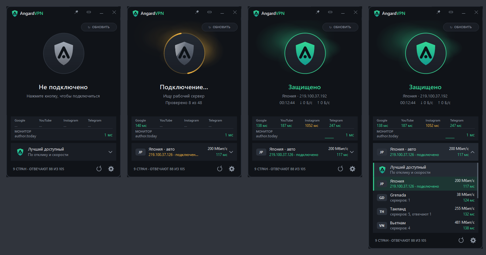
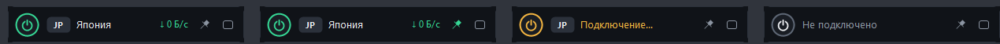
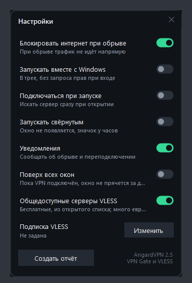

# AngardVPN — free one-click VPN for Windows (VLESS, Reality, Trojan, Shadowsocks, Hysteria2)

**[English](#english) · [Русский](#русский)**

  

---

## English

**AngardVPN** is a free VPN client for Windows 10 and 11 with a single button. It finds working
servers by itself, measures their ping and real download speed, and connects you to the fastest one.
No registration, no account, no subscription, no ads.

It is built for places where the internet is censored. YouTube, Instagram, Telegram, ChatGPT and news
sites open through the tunnel. Servers whose exit is in a country with heavy blocking are skipped
automatically.

### Why AngardVPN

- **One click.** Press the shield and wait. The app picks the server for you.
- **Picks the fastest server.** Each server is checked for ping and real download speed before
  connecting. Slow and dead servers are dropped.
- **Modern protocols** that are hard to block: VLESS (including Reality and XTLS Vision), Trojan,
  VMess, Shadowsocks and Hysteria2, powered by the [sing-box](https://github.com/SagerNet/sing-box) core.
  Classic OpenVPN servers from [VPN Gate](https://www.vpngate.net) are supported too.
- **Whole-system VPN (TUN).** All apps go through the tunnel, not only the browser.
- **Kill switch.** If the tunnel drops, traffic is blocked so your real IP does not leak.
- **Compact mode.** Shrink the window to one small bar: power button, country and live speed.
- **Always on top while connected** (optional), in both the full window and the compact bar.
- **Live monitor** of ping to Google, YouTube, Instagram, Telegram and a site of your choice.
- **Your own subscription.** Add your own VLESS subscription link if you have one.
- **Small and light.** One 190 KB app plus the sing-box engine. It runs on the .NET Framework 4.8
  that ships with Windows. Lives in the system tray.

### Download

Get the latest version on the **[Releases page](../../releases/latest)**:

- `AngardVPN-Setup-2.5.exe` — installer (it can also install OpenVPN for VPN Gate servers);
- `AngardVPN-2.5-portable.zip` — portable version: unpack anywhere and run `AngardVPN.exe`.

Windows asks for administrator rights. They are needed to create the VPN network adapter.

  

### Important

The servers are **public and free**. They are collected from open lists and do not belong to
AngardVPN. Their owners may see unencrypted traffic, so use https and do not log in to banks
through them. Do not run AngardVPN together with another VPN, because they get in each other's way.

### Build from source

Requirements: Windows 10/11 with .NET Framework 4.8 (the C# compiler that ships with Windows is enough;
Visual Studio is not needed).

1. Download `sing-box-1.14.4-windows-amd64.zip` from
   [sing-box releases](https://github.com/SagerNet/sing-box/releases/tag/v1.14.4). Put `sing-box.exe`
   and `libcronet.dll` into the `engine` folder. Unpack the archive into `build\singbox-dl` so the
   packaging script can find the license.
2. Run `powershell -ExecutionPolicy Bypass -File build.ps1`. This runs the tests and builds `AngardVPN.exe`.
3. Optional: `package.ps1` builds the installer and the portable zip in `dist`.

### Keywords

free VPN for Windows, VPN for Windows 10, VPN for Windows 11, one-click VPN, VLESS client for Windows,
VLESS Reality, sing-box GUI, Hysteria2 client, Shadowsocks client, Trojan client, V2Ray client,
VPN Gate client, unblock YouTube, unblock Instagram, unblock Telegram, bypass censorship, kill switch,
no registration VPN, open-source VPN client.

---

## Русский

**AngardVPN** — бесплатный VPN для Windows 10 и 11, в котором одна кнопка. Программа сама находит
рабочие серверы, проверяет их пинг и настоящую скорость загрузки и подключает к самому быстрому.
Без регистрации, без аккаунта, без подписки и без рекламы.

Сделан для обхода блокировок. Через него открываются YouTube, Instagram, Telegram, ChatGPT и
заблокированные новостные сайты. Серверы, у которых выход в стране с сильной цензурой, программа
отбрасывает сама.

### Почему AngardVPN

- **Одна кнопка.** Нажмите на щит и подождите. Сервер программа выберет сама.
- **Самый быстрый сервер.** Перед подключением у каждого сервера проверяются пинг и реальная скорость.
  Медленные и мёртвые отбрасываются.
- **Современные протоколы**, которые трудно заблокировать: VLESS (в том числе Reality и XTLS Vision),
  Trojan, VMess, Shadowsocks и Hysteria2 на движке [sing-box](https://github.com/SagerNet/sing-box).
  Поддерживаются и обычные серверы OpenVPN из [VPN Gate](https://www.vpngate.net).
- **VPN для всей системы (TUN).** Через туннель идут все программы, а не только браузер.
- **Блокировка при обрыве (kill switch).** Если туннель упал, трафик останавливается и ваш
  настоящий IP не утекает.
- **Режим «строка».** Окно сворачивается в маленькую полоску: кнопка, страна и текущая скорость.
- **Поверх всех окон, пока VPN подключён.** Включается булавкой, работает и в большом окне, и в строке.
- **Живой монитор** пинга до Google, YouTube, Instagram, Telegram и вашего сайта.
- **Своя подписка.** Если у вас есть своя ссылка-подписка VLESS, её можно добавить.
- **Маленький и лёгкий.** Программа весит 190 КБ, плюс движок sing-box. Работает на .NET Framework 4.8,
  который уже есть в Windows. Живёт в трее у часов.

### Скачать

Последняя версия на **[странице релизов](../../releases/latest)**:

- `AngardVPN-Setup-2.5.exe` — установщик (может поставить и OpenVPN для серверов VPN Gate);
- `AngardVPN-2.5-portable.zip` — переносимая версия: распакуйте куда угодно и запустите `AngardVPN.exe`.

Windows попросит права администратора. Они нужны, чтобы создать сетевой адаптер VPN.

  

### Важно знать

Серверы **общедоступные и бесплатные**. Они собираются из открытых списков и не принадлежат
AngardVPN. Их владельцы могут видеть незашифрованный трафик, поэтому пользуйтесь https и не входите
через них в банк. Не включайте AngardVPN вместе с другим VPN: они мешают друг другу.

### Сборка из исходников

Нужна Windows 10/11 с .NET Framework 4.8. Хватает компилятора C#, который уже есть в Windows;
Visual Studio не нужна.

1. Скачайте `sing-box-1.14.4-windows-amd64.zip` со
   [страницы релизов sing-box](https://github.com/SagerNet/sing-box/releases/tag/v1.14.4). Положите
   `sing-box.exe` и `libcronet.dll` в папку `engine`. Распакуйте архив в `build\singbox-dl`: оттуда
   скрипт упаковки берёт лицензию.
2. Запустите `powershell -ExecutionPolicy Bypass -File build.ps1`. Скрипт прогонит тесты и соберёт `AngardVPN.exe`.
3. По желанию: `package.ps1` соберёт установщик и переносимый архив в папке `dist`.

### Ключевые слова

бесплатный VPN для Windows, VPN для Windows 10, VPN для Windows 11, VPN без регистрации, VPN в одну кнопку,
обход блокировок, VLESS клиент для Windows, VLESS Reality, клиент sing-box, Hysteria2, Shadowsocks, Trojan,
V2Ray клиент, VPN Gate, открыть YouTube, открыть Instagram, открыть Telegram, VPN для России и Беларуси,
блокировка при обрыве, VPN с открытым исходным кодом.

---

Third-party components: sing-box (GPL-3.0), OpenVPN (GPL-2.0). They are shipped unmodified;
see `licenses` in the release package. Сторонние компоненты: sing-box (GPL-3.0), OpenVPN (GPL-2.0),
поставляются без изменений, лицензии — в папке `licenses` внутри пакета.
